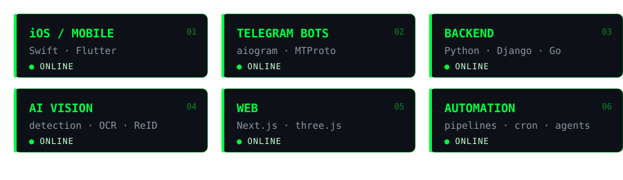

<div align="center">



<br/>




</div>

<br/>

## `> cat ~/about.md`

```yaml
handle:   SS010
role:     full-stack / mobile / automation
focus:    [ ios-clients, telegram-bots, ai-vision, backend ]
approach: ship small → measure → harden
motto:    "looks right" != "done"
```

<br/>

## `> modules --status`

<div align="center">

</div>

<br/>

## `> stack --list`

<div align="center">


<br/>


</div>

<br/>

## `> ping`

<div align="center">

[](https://t.me/saidsaddam)


</div>
